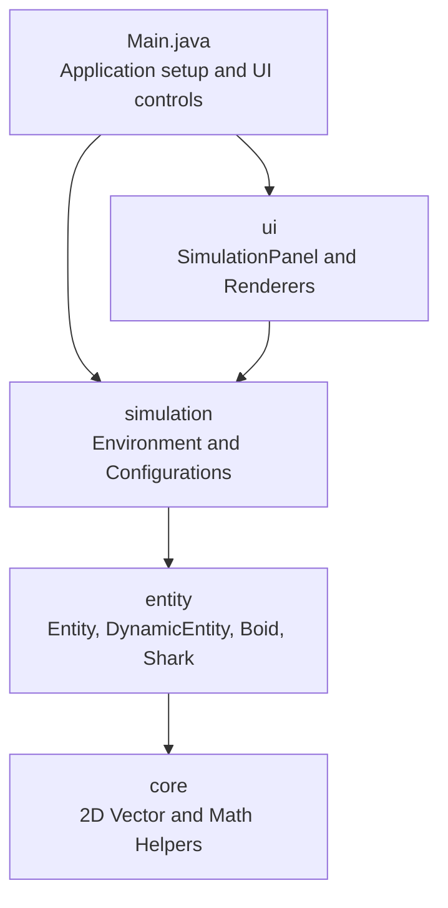

# Flock Simulation

A 2D flocking simulation built with **Java and Swing**, inspired by Craig Reynolds' Boids model. The project simulates a group of autonomous agents (boids) whose movement emerges from a small set of local steering rules. It also introduces a predator-prey interaction through a controllable shark.

> **Main purpose:** an educational project for learning and practicing Object-Oriented Programming (OOP), basic software architecture, 2D vector mathematics, and simulation logic.

## Overview

Each boid moves through a 2D world by continuously updating its position, velocity, and acceleration. Instead of following a predefined path, it observes nearby boids and combines several steering forces to produce flock-like movement.

The simulation includes:

- **2D vector-based movement** — position, velocity, acceleration, and steering forces are represented with 2D vectors.
- **Boids flocking behavior** — Separation, Alignment, and Cohesion work together to create coordinated group movement.
- **Cruise-speed improvement** — a minimum cruising-speed mechanism helps boids maintain more consistent movement when their velocity becomes too low.
- **Predator-prey interaction** — sharks detect and chase boids in their field of view, while boids attempt to flee from nearby sharks.
- **Interactive controls** — adjust flocking weights and shark parameters, and add boids or sharks while the simulation is running.
- **Boundary avoidance** — entities can steer away from the edges of the simulation area.

## Features

### 1. 2D movement and vector mathematics

The simulation takes place in a 2D coordinate system. Each moving entity has three essential motion properties:

- **Position:** where the entity is in the world.
- **Velocity:** its current movement direction and speed.
- **Acceleration:** the accumulated steering forces that affect its velocity.

The `core` package provides a lightweight vector utility and calculation helpers for operations such as addition, subtraction, normalization, magnitude, dot product, and distance calculation.

### 2. Boids algorithm

Each boid evaluates nearby boids and calculates three steering behaviors. The resulting forces are weighted and combined before the boid moves.

| Behavior | Description |
| --- | --- |
| **Separation** | Steers away from nearby boids to prevent agents from crowding or overlapping. |
| **Alignment** | Steers toward the average velocity of neighboring boids, encouraging them to travel in a similar direction. |
| **Cohesion** | Steers toward the average position of neighboring boids, encouraging the flock to stay together. |

Each behavior has its own neighborhood radius and configurable weight. The steering calculation uses the average neighborhood vector, desired velocity, current velocity, and a maximum steering-force limit. This keeps the movement gradual rather than allowing sudden, unrestricted direction changes.

### 3. Cruise-speed improvement

The standard steering behaviors can sometimes reduce a boid's speed considerably, especially when several steering forces compete. To make the flock's movement more consistent, this project introduces `cruiseSpeed`.

When a boid's current speed falls below its cruise-speed threshold, an additional steering force gently accelerates it along its current direction. The force is scaled and limited by the boid's maximum steering force.

This is a minimum-speed assistance mechanism, not a replacement for `maxSpeed`: boids can still move faster than their cruise speed, but their speed is encouraged not to remain too low.

### 4. Predator-prey interaction

The simulation also contains a `Shark` entity to make the environment more dynamic:

- A shark checks boids inside its detection radius and field-of-view angle.
- It selects the nearest visible boid and steers toward it.
- A boid inside the shark's eating radius is marked for removal.
- Boids calculate a **Flee** steering response when a shark gets close enough.

The shark's size, speed, and detection range can be adjusted through the UI controls.

### 5. Interactive simulation

The Swing interface provides controls for experimenting with the simulation without changing the source code:

- Adjust **Separation**, **Alignment**, and **Cohesion** weights.
- Add more boids to the environment.
- Adjust shark size, speed, and vision range.
- Add more sharks.

The simulation panel uses a timer-based update loop (approximately 60 updates per second) and repaints the world after each update.

## Architecture

The code is organized around an **MVC-inspired architecture**, with responsibilities separated into simulation data and behavior, rendering, and application-level UI wiring.



### Package responsibilities

| Package / file | Responsibility |
| --- | --- |
| `core` | Reusable 2D vector operations and mathematical helpers. |
| `entity` | Entity hierarchy and movement behavior. `Entity` is the base abstraction; `DynamicEntity` adds velocity, acceleration, and common movement methods; `Boid` and `Shark` implement their own behaviors. |
| `simulation` | `Environment` manages entities and simulation updates. Configuration classes store world, boid, and shark parameters. |
| `ui` | Swing simulation panel and renderer classes responsible for drawing boids and sharks. |
| `Main.java` | Application entry point; creates the world, initializes the UI, and connects controls to configuration values. |

**Design note:** this is an MVC-inspired learning project rather than a strict implementation of textbook MVC. In the current code, `Main` wires UI events to the model/configuration objects, while `SimulationPanel` both displays the simulation and owns the timer that triggers updates. Separating the update loop into a dedicated controller or simulation runner would be a natural future refactoring exercise.

## Project structure

```text
FlockSimulation/
├── Main.java
├── core/
│   ├── calc.java
│   └── vector.java
├── entity/
│   ├── Entity.java
│   ├── DynamicEntity.java
│   ├── Boid.java
│   └── Shark.java
├── simulation/
│   ├── Environment.java
│   ├── WorldConfig.java
│   ├── BoidConfig.java
│   └── SharkConfig.java
└── ui/
    ├── SimulationPanel.java
    ├── BoidRenderer.java
    └── SharkRenderer.java
```

## OOP concepts demonstrated

This project is intended to be explored as an OOP learning exercise. Some of the concepts visible in the code are:

- **Abstraction:** `Entity` defines the common contract for objects that can act in an environment.
- **Inheritance:** `DynamicEntity` extends `Entity`; `Boid` and `Shark` extend `DynamicEntity` and reuse shared movement logic.
- **Polymorphism:** the environment updates different entity types through their shared `act(...)` contract, while each subtype provides its own implementation.
- **Encapsulation:** positions, velocities, configuration values, and behavior parameters are managed through classes and methods rather than being handled entirely in the UI.
- **Composition:** `Environment` contains collections of boids and sharks and references the configuration objects that define the world.
- **Separation of concerns:** simulation behavior, reusable math, rendering, and application setup are organized into different packages.

## Technologies

- **Language:** Java (Java 8 or later recommended)
- **GUI:** Java Swing / AWT
- **Graphics:** `Graphics2D` for rendering and rotating entities according to their velocity direction
- **Build system:** no Maven or Gradle configuration is currently included; the source can be compiled directly with `javac`.

No third-party library is required by the current source code.

## Getting started

### Prerequisites

- Install a JDK (Java 8 or later).
- Make sure `java` and `javac` are available in your terminal, or run the project from a Java IDE such as IntelliJ IDEA or Eclipse.

### Run on Windows PowerShell

1. Make sure you have all five `.java` files in the same directory.
2. Open your terminal or command prompt and navigate to the directory.
3. Compile the Java files:
   ```bash
   javac *.java
   ```
4. Run the application:
   ```bash
   java Main
   ```
## Learning goals

By exploring and extending this project, you can practice:

1. Designing class hierarchies and deciding which behavior belongs in a base class or a subclass.
2. Modeling motion with vectors and combining multiple forces.
3. Translating a mathematical behavior model into object-oriented code.
4. Separating simulation state from rendering and UI controls.
5. Managing an update loop and synchronizing simulation updates with screen repainting.
6. Using configuration objects to make behavior adjustable at runtime.
7. Refactoring an MVC-inspired application toward cleaner separation of responsibilities.

## Possible extensions

Ideas for future experiments and improvements:

- Add a pause/resume button and a reset function.
- Add a control for the boids' cruise speed and maximum speed.
- Visualize each boid's neighborhood radius and steering direction.
- Allow the user to switch between edge avoidance and screen wrapping.
- Add obstacles that boids must avoid.
- Extract the simulation update loop from `SimulationPanel` into a dedicated controller or runner.
- Introduce interfaces for different steering behaviors to make the system easier to extend.
- Add unit tests for vector calculations and steering behavior.
- Add a spatial partitioning structure (such as a uniform grid) if the number of boids becomes large.
---

This project is primarily an educational OOP and simulation playground. It is intended to be read, modified, and extended as a way to learn how small, independent object behaviors can produce complex collective movement.
